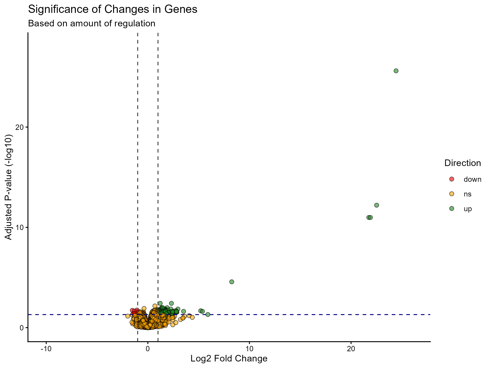
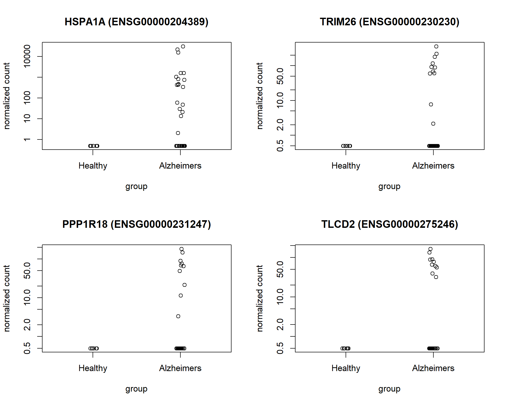
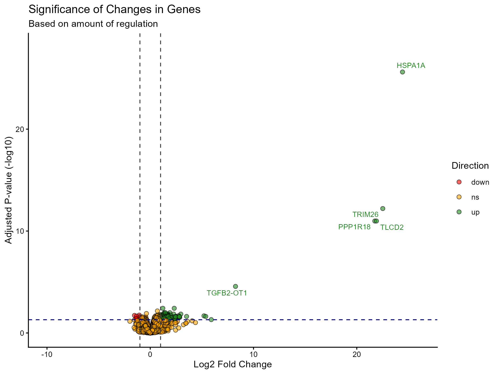
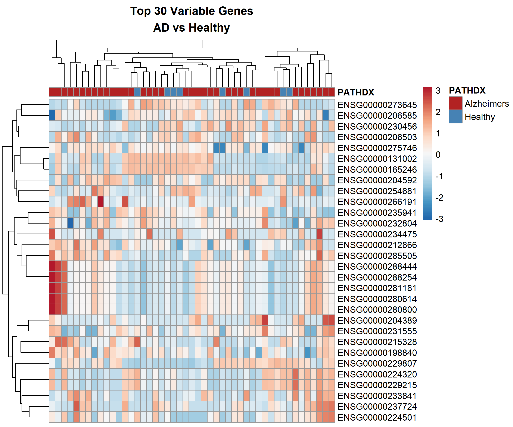

# Alzheimer's Disease Brain RNA-seq: Differential Expression Analysis (GSE203206)

Differential expression analysis of post-mortem primary visual cortex samples from 39 people with Alzheimer's disease (AD) and 8 healthy controls, using **DESeq2** in R, with volcano plots and a heatmap built in **ggplot2**, **ggrepel** and **pheatmap**. The data comes from Caldwell et al. (2022), published in *Molecular Brain*.

This is a self-directed learning project that applies a standard RNA-seq workflow to a published dataset. It is a simplified analysis and does not reproduce the full methods of the paper (see [Limitations](#limitations)).

## Research question

Which genes differ in expression between Alzheimer's disease and healthy controls in the primary visual cortex, and how reliable is the evidence?

## Key terms

- **Gene expression:** how active a gene is.
- **Log2 fold change:** how much higher or lower a gene is in Alzheimer's than in healthy samples. A value of 0 means no change, 1 means twice as high, and -1 means half as high.
- **Adjusted p-value:** a measure of how strong the evidence is that a difference is real and not random. Smaller values mean stronger evidence. A cut-off of 0.05 was taken, as it is the most common choice.
- **Volcano plot:** each dot is a gene. The further left or right, the bigger the change. The higher up, the stronger the evidence.
- **Heatmap:** colours show how high or low each gene is in each sample.

## Data source

| Item | Detail |
|---|---|
| Source | NCBI Gene Expression Omnibus (GEO), accession [GSE203206](https://www.ncbi.nlm.nih.gov/geo/query/acc.cgi?acc=GSE203206) |
| Tissue | Occipital lobe, primary visual cortex (Brodmann area 17), post-mortem samples from the UC San Diego Shiley-Marcos Alzheimer's Disease Research Center |
| Samples | 47 in total: 39 Alzheimer's disease and 8 healthy, non-demented controls |
| Sequencing | Illumina HiSeq 4000, paired-end 75 bp reads |
| Files used | Gene-level count matrix and sample metadata (processed data, not raw reads) |

The count matrix contains non-integer (estimated) values, consistent with the paper's description of summarising kallisto transcript abundances to gene level, so counts were rounded to whole numbers before running DESeq2. The metadata column `PATHDX` (`Alzheimers` or `Healthy`) defines the comparison. The raw sequencing reads (FASTQ files) are held in the Sequence Read Archive (SRA) and were not used.

### How the data was downloaded

The data is not stored in this repository. To reproduce the analysis:

1. Go to the GEO page: <https://www.ncbi.nlm.nih.gov/geo/query/acc.cgi?acc=GSE203206>
2. Scroll to the **Supplementary file** table at the bottom of the page.
3. In the **Download** column, click **(http)** next to each of these two files:
   - `GSE203206_Subramaniam.ADRC_brain.counts.tsv.gz` (about 8.9 MB)
   - `GSE203206_Subramaniam.ADRC_brain.metadata.tsv.gz` (about 1.8 KB)
4. Extract both `.gz` files (for example with 7-Zip) to get the two `.tsv` files.
5. Save both `.tsv` files in the folder you set with `setwd()` in the script.

## Methods summary

1. Loaded the count matrix and metadata, rounded counts to integers, and checked that sample order matched.
2. Built a DESeq2 object with the design `~ PATHDX` (Alzheimer's) and `Healthy` as the baseline (reference) group, so a positive log2 fold change means higher expression in Alzheimer's disease.
3. Filtered out genes with fewer than 10 reads in total across all samples, then ran DESeq2.
4. Extracted results and removed genes with an `NA` adjusted p-value.
5. Called genes `up` or `down` where the adjusted p-value is below 0.05 **and** the log2 fold change is above 1 or below -1.
6. Converted Ensembl IDs to gene symbols with `org.Hs.eg.db`.
7. Drew volcano plots, labelling the five most significant genes.
8. Drew a heatmap of the 30 most variable genes (variance-stabilised counts, z-scored per gene), with samples annotated by diagnosis.
9. Plotted the counts of the four most extreme genes in each group to check the results.

**Tools:** R, DESeq2, ggplot2, ggrepel, pheatmap, RColorBrewer, org.Hs.eg.db

## Key findings

### 1. Few genes show strong evidence of differential expression

| Measure | Result |
|---|---|
| Samples | 39 Alzheimer's disease, 8 Healthy |
| Genes tested (after filtering) | 18,286 |
| Adjusted p-value < 0.05 | 382 (2.1%) |
| Also, the log2 fold change above 1 or below -1 | 213 |
| Higher in Alzheimer's disease | 203 |
| Lower in Alzheimer's disease | 10 |

Most of the 213 genes have only modest statistical support: 206 have an adjusted p-value between 0.01 and 0.05, only 7 are below 0.01, and just 5 are below 0.0001.



### 2. The four most significant genes have fold changes that are not biologically plausible

| Gene | Ensembl ID | log2 fold change | Adjusted p-value |
|---|---|---|---|
| HSPA1A | ENSG00000204389 | 24.4 | 2.5e-26 |
| TRIM26 | ENSG00000230230 | 22.5 | 6.2e-13 |
| TLCD2 | ENSG00000275246 | 21.9 | 1.0e-11 |
| PPP1R18 | ENSG00000231247 | 21.7 | 1.0e-11 |

A log2 fold change above 20 means a difference of more than a million-fold, which is not biologically plausible. These genes also have large standard errors (2.1 to 2.8) and modest average expression (15 to 169). To investigate, the counts for these four genes were plotted for each group:



In all four genes, every healthy sample has zero or near-zero counts, while only some of the Alzheimer's samples have counts. When one group is entirely zeros, DESeq2 can return extremely large fold changes, so these results are likely to be technical errors and not real differences.

Other details point the same way:

- HSPA1A, TRIM26 and PPP1R18 lie in the major histocompatibility complex (MHC) region on chromosome 6, which is highly polymorphic and contains near-identical gene copies, so reads can be assigned inconsistently.
- The results contain five different Ensembl IDs annotated as HSPA1A and five annotated as HSPA1B, which fits with reads being shared between near-identical copies of these genes.
- HSPA1A encodes a heat-shock (stress-response) protein, and genes like this can be sensitive to the circumstances of death and tissue handling.

I therefore treat these four as probable technical errors and do not interpret them biologically. They are kept in the plots and tables for transparency.



### 3. The remaining top genes

| Gene | Ensembl ID | log2 fold change | Adjusted p-value |
|---|---|---|---|
| TGFB2-OT1 | ENSG00000281453 | 8.3 | 2.7e-5 |
| TMEM54 | ENSG00000121900 | 1.2 | 0.0038 |
| SAMD11 | ENSG00000187634 | 2.3 | 0.0038 |
| FLT4 | ENSG00000037280 | 1.9 | 0.010 |
| CLEC18A | ENSG00000157322 | 1.4 | 0.010 |
| C1QTNF5 | ENSG00000223953 | 1.5 | 0.010 |

TGFB2-OT1, annotated as a long non-coding RNA, is the most significant gene outside the group above. Its fold change is also large and uncertain (standard error 1.4, average expression 35). The other five genes pass the thresholds with moderate fold changes, but their evidence is weaker.

### 4. Evidence for lower expression in Alzheimer's disease is weak

Only 10 genes are lower in Alzheimer's disease by more than two-fold (log2 fold change between -1.0 and -1.5). All 10 have adjusted p-values between 0.018 and 0.049, and four have no gene symbol. Those with symbols include CAMK1G, SVEP1 and NELL1.

### 5. The most variable genes do not separate the two groups



In the heatmap, healthy samples (blue) are scattered among the Alzheimer's samples rather than forming their own cluster, so the largest sources of variation in the data are not diagnosis. Three patterns stand out:

- **MHC region genes.** 14 of the 30 rows are genes from the MHC region of chromosome 6: nine are HSPA1A or HSPA1B (five and four different Ensembl IDs) and five are HLA genes (three HLA-A, one HLA-C and one HLA-E). Reads can be shared between near-identical copies of these genes, which can add noise.
- **Five identical rows.** A block of five genes (ENSG00000288444, ENSG00000288254, ENSG00000281181, ENSG00000280614, ENSG00000280800) has exactly the same average expression, fold change (2.8) and adjusted p-value (0.025), with very high expression in the same three Alzheimer's samples at the left edge. These are probably duplicate entries for one region and not five separate genes.
- **Sex-linked genes.** Two rows are sex-linked genes (NLGN4Y on the Y chromosome and XIST, which is active in females), which suggests that sex is another source of variation that was not accounted for.

This suggests that a handful of samples, together with factors other than diagnosis, may be driving much of the variance and some of the strongest results.

## Overall interpretation

In this simplified analysis, the evidence for differential expression between Alzheimer's disease and healthy visual cortex is weak and uneven. A few genes drive the strongest results, those genes show signs of technical errors, and the most variable genes do not separate the two groups. The imbalance towards higher expression in Alzheimer's disease (203 genes versus 10) should not be read as biology without further checks. I would not draw biological conclusions from this analysis alone. Sample-level quality control and covariate adjustment (accounting for factors such as sex and RNA quality), as done in the paper, would be the next priority.

## Limitations

- **Unbalanced groups.** There are 39 Alzheimer's samples but only 8 healthy controls, which reduces statistical reliability and makes estimates for the control group unstable.
- **No covariate adjustment.** Sex, RNA integrity and age are not in the analysis, so they could confound the results (two sex-linked genes are among the 30 most variable genes). The paper accounted for sex and RNA integrity.
- **No sample-level quality control.** I did not check for outlier samples or RNA degradation. The paper excluded one cluster showing degradation signatures.
- **Fold changes not adjusted for low counts.** Log2 fold changes were not adjusted, which produces extreme values for low-count genes (see Finding 2).
- **Different statistics.** The paper used limma-voom and this project uses DESeq2, so gene lists will not match exactly.
- **Gene annotation.** 2,218 of the 18,286 tested genes (12.1%) have no gene symbol, including 25 of the 213 significant genes. Heatmap rows show Ensembl IDs rather than symbols.
- **Conventional thresholds.** The cut-offs (adjusted p-value < 0.05 and |log2 fold change| > 1) are common choices, not the only valid ones.
- **No functional analysis.** Pathway or enrichment analysis was not run, so the biological processes involved were not examined and no conclusions are drawn about them.
- **Small post-mortem cohort.** Results describe associations in a small set of brain bank samples, from one dataset with no independent validation, and are not evidence of cause.

## Possible next steps

- Adjust fold-change for low-count genes with `lfcShrink()`.
- Check for outlier samples with a PCA plot and add covariates such as sex and RNA quality in the analysis.
- Restrict to well-annotated genes and review genes in the MHC region.
- Label heatmap rows with gene symbols.
- Run pathway enrichment on the significant genes.

## Reproducing the analysis

**Tested with:** R 4.6.0 on Windows 10, DESeq2 1.52.0, ggplot2 4.0.4, ggrepel 0.9.8, pheatmap 1.0.13, RColorBrewer 1.1-3, org.Hs.eg.db 3.23.1, AnnotationDbi 1.74.0. The full session is saved in `results/session_info.txt`.

Install the packages once:

```r
install.packages("BiocManager")
BiocManager::install(c("DESeq2", "org.Hs.eg.db"))
install.packages(c("ggplot2", "ggrepel", "pheatmap", "RColorBrewer"))
```

Then:

1. Download and extract the two data files (see [How the data was downloaded](#how-the-data-was-downloaded)).
2. Open `alzheimers_deseq2_analysis.R` in RStudio and change the `setwd()` line to your data folder.
3. Run the script from top to bottom. It creates the `results/` and `figures/` folders and saves all tables and plots.

## Repository structure

```
alzheimers-rnaseq-deseq2/
├── alzheimers_deseq2_analysis.R
├── figures/
│   ├── volcano_plot.png
│   ├── volcano_labelled.png
│   ├── heatmap_top30.png
│   └── extreme_genes_counts.png
├── results/
│   ├── summary_counts.csv
│   ├── deseq2_all_results.csv
│   ├── significant_genes.csv
│   ├── top10_genes.csv
│   └── session_info.txt
└── README.md
```

The data files are not included. Download them from GEO as described above.

## Reference

Caldwell AB, Anantharaman BG, Ramachandran S, Nguyen P, Liu Q, Trinh I, Galasko DR, Desplats PA, Wagner SL, Subramaniam S. Transcriptomic profiling of sporadic Alzheimer's disease patients. *Molecular Brain*. 2022;15(1):83. doi: [10.1186/s13041-022-00963-2](https://doi.org/10.1186/s13041-022-00963-2)

Data: NCBI GEO accession [GSE203206](https://www.ncbi.nlm.nih.gov/geo/query/acc.cgi?acc=GSE203206)

## Author

Amulya Carmel Pinto - [LinkedIn](https://www.linkedin.com/in/amulya-pinto-2509)